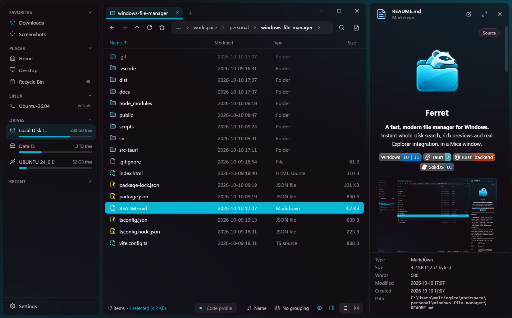
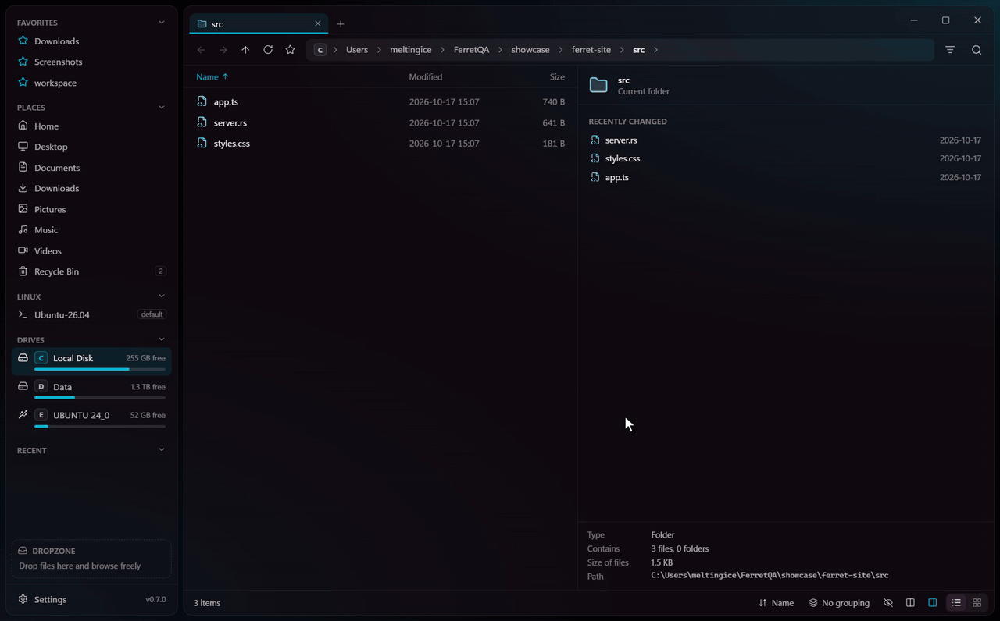

<p align="center">
  
</p>

<h1 align="center">Ferret</h1>

<p align="center">
  <b>A fast, modern file manager for Windows.</b><br>
  Instant whole-disk search, rich previews and real Explorer integration, in a Mica window.
</p>

<p align="center">
  
  
  
  
</p>

<p align="center">
  
</p>

---

## Features

**⚡ Instant search — `Ctrl+K`**
Fuzzy search over every file on every drive, ranked by name match and how often you open things.
Filters: `ext:pdf,docx` · `type:folder` · `size:>100mb` · `modified:<7d` · `dm:2026-03-04` · `in:"C:\Program Files"` · `!node_modules\` · globs like `*.rs`.
Filters are suggested as you type (`Tab` completes them). Running WSL distros are searchable too: each is listed from inside Linux and refreshed every 15 minutes, and a stopped distro is never started just to be indexed.
Search inside files with `content:"some text"`: it reads the files in the open folder (or the one named with `in:`), and each result shows the line with the text. The other filters narrow which files are read; binary files and `node_modules` are skipped.
Recent searches come back when you open `Ctrl+K`, and any search can be saved to the sidebar (☆). `Ctrl+Shift+Enter` opens every match as a tab that lists them like a folder and stays current.

**👁 Previews — `Alt+P`, or `Space` for Quick Look**
Images, video, audio, PDF, Word (`.docx`), Markdown, CSV, fonts, SVG and syntax-highlighted code. A hex view for everything else, plus version and CPU architecture details for `.exe` and `.dll` files.
A file changed while it's shown (saved from an editor, say) is shown again as it is now. Click the path in the details to copy it.

**🗜 Archives as folders**
Browse, preview and extract `zip`, `7z`, `rar` and `tar` (`.gz`, `.xz`, `.zst`, `.bz2`) archives as if they were folders, or compress files into one.

**🎬 Shrink videos and pictures**
Right-click → **Compress video…** / **Compress picture…** opens an editor that shows the result's size before you commit (for example, a 132 MB phone screen recording came out at about 9 MB with the Small preset).
- Video: presets (Small, Balanced, High quality, Fit 10 MB for Discord and chats), quality or target file size, resolution, frame rate, H.264 or HEVC, keep or remove the sound, and trimming on a timeline with frame previews (`I` / `O` set the ends, `Space` plays)
- **Preview quality** encodes a few seconds with your settings: compare it with the original side by side with a slider while both play, and the size estimate becomes a measured one
- Pictures: a before/after slider with zoom to actual pixels, a **Differences** view that lights up what compression changed, JPEG quality, longest side, and Auto format (PNG for pictures with transparency, JPEG for the rest). The size shown is exact. Photos are turned upright, and location and camera details aren't copied
- Several files at once with the same settings; the originals are never touched and the result can be undone
- Uses Windows' own encoders (the GPU for video), so there is nothing extra to install or download. iPhone videos (HEVC) and photos (HEIC) need Microsoft's free HEVC / HEIF extensions, which Ferret points to when they're missing

**🪟 Feels like Windows, only faster**
- The real Explorer context menu, including third-party entries (7-Zip, Git, VS Code, PowerToys…)
- Properties and Open with dialogs, and a clipboard that works with Explorer
- Copy, move and delete in the background with progress and conflict handling, plus undo/redo. Deleting thousands of items keeps the window responsive, a file that's in use asks **Try again / Skip / Skip all** instead of stopping everything, and emptying the Recycle Bin shows its progress and can be canceled
- Asks before a rename changes a file's extension
- Recycle Bin you can browse and restore from
- Asks for admin rights only when a protected folder needs it, and any window can restart as administrator with its tabs intact
- Drag files to and from other apps, including switching apps with `Alt+Tab` mid-drag
- Middle-click autoscroll, like Explorer: press the mouse wheel and move away from that point to scroll (hold it, or click once to follow the mouse until the next click)
- Windows 11-style menus, and each window is named after its folder in the taskbar and `Alt+Tab`, like Explorer
- Optional: make Ferret the default file manager (Win+E, folder double-clicks), with a one-click switch back. Apps' "Show in folder" opens Ferret too, with the file selected when the app passes it to Explorer: a small background helper swaps in Ferret before Explorer's window appears, and Control Panel and other non-folder windows stay in Explorer. Uninstalling Ferret gives folders back to Explorer

**◫ Split view — `Ctrl+\`**
Two folders side by side in one tab, each with its own history and selection. `Tab` switches between them, and the toolbar, preview and shortcuts follow the one you're in. Copy or move to the other pane from **Copy to ▸** / **Move to ▸**, the command palette, or by dragging across. Split tabs come back after a restart.

**🗂 Built for keyboards and many tabs**
Tabs (`Ctrl+T`, `Ctrl+Shift+T`), a command palette (`Ctrl+Shift+P`), folder filter (`Ctrl+F`), editable path bar (`Ctrl+L`), favorites (`Ctrl+D`), and open in terminal (`` Ctrl+` ``) or VS Code.
List or grid view with grouping by date, type, size or letter. Each folder remembers its own view, and folder types have presets.
Resize list columns by dragging, hide them by right-clicking the headings, and show only one type of file (pictures, documents, code…) from the toolbar.
Folder sizes appear in the Size column, counted in the background at low priority (can be turned off in Settings).
Recent folders are ranked by how often and how recently you use them. A folder counts once you stay in it for a moment, not when you pass through it.

**🐧 Plays well with others**
WSL distros, network (UNC) paths and all drives in the sidebar. Folders refresh live when their contents change.

**🎨 Make it yours**
Dark, light or system theme, with a Mica, Acrylic or solid backdrop. Pick any accent color and a comfortable or compact layout. Short, Fluent-style animations, which you can turn off in Settings (and which stay off when Windows' animation effects are off).

**🔄 Stays up to date**
Updates come from GitHub Releases: Ferret shows what's new, then updates and restarts in one click. If something goes wrong, Settings → **Open logs** has the app's log files.

---

## Demo

Code previews, filtering a folder, a Word document, `Ctrl+K` (names, then text inside files) and split view, in 30 seconds:

<p align="center">
  
</p>

---

##  Ferret Indexer (optional)

Without setup, search scans your drives in the background and watches for changes.
For **instant results on every NTFS drive**, enable the **FerretIndexer** service from inside Ferret (one UAC prompt).
It reads the NTFS file table (MFT) and follows the change journal (USN), so the index stays current without rescanning.

- Runs as its own small process, `ferret-indexer.exe`, and talks to Ferret over a named pipe
- Only returns results from folders the requesting user is allowed to list
- Also gives the Size column every folder's size at once, as WizTree does: it reads the file table once (about 5 s for a drive with a million files, where walking it took 36 s) and follows the change journal from there. Folders the user can't open are left out, as Ferret's own count does
- Saves index snapshots to `%PROGRAMDATA%\Ferret`, readable only by SYSTEM and Administrators
- Runs from its own copy in `%PROGRAMDATA%\Ferret\bin`. When Ferret updates, it has the service update itself to the same release, without a click or a UAC prompt: the service installs only a newer `ferret-indexer.exe` signed with Ferret's release key (so a copy swapped into Ferret's own folder can't become the service). Services installed by Ferret before 0.8.0 ask once (one UAC prompt)

```text
ferret-indexer --install | --uninstall | --status | --query <text> | --sizes <folder>... | --console | --probe
```

---

## Development

**Requirements:** Windows 10/11, [Rust](https://rustup.rs) with its Linux target (`rustup target add x86_64-unknown-linux-musl`, for the WSL folder-size helper), Node.js 22.12 or newer (an LTS version, like 24 or 26) with Yarn 4, and WebView2 (included with Windows 11). Yarn comes through Corepack: `npm install -g corepack` then `corepack enable`, and the project picks its own Yarn version (`packageManager` in `package.json`).

```powershell
yarn                  # install
yarn app:dev          # run the app with hot reload
yarn tauri build      # release build + installer
yarn test             # unit tests (yarn test:e2e for the end-to-end run)
```

`app:dev` runs a development build under its own app identity (`com.ferret.dev`), with its own settings, a "Ferret (Dev)" window title and an icon with a DEV badge. It can run next to the installed app without the two being mixed up. Releases are published with `scripts/release.sh`.

| Path | What's there |
| --- | --- |
| `src/` | UI (SolidJS + TypeScript) |
| `src-tauri/src/` | Backend: file operations, shell integration, archives, previews |
| `src-tauri/src/search/` | Search engine, MFT/USN indexer, named-pipe protocol |
| `src-tauri/src/bin/ferret-indexer.rs` | Entry point of the indexer service |
| `src-tauri/src/redirect.rs` | Background helper that opens Explorer's folder windows in Ferret |
| `src-tauri/src/media.rs` | Video (Media Foundation transcoder) and picture (WIC) compression |
| `src-tauri/wsl-size` | Linux program that counts folder sizes inside WSL (static, built into the app) |
| `src-tauri/vendor/drag` | Patched copy of the `drag` crate (dragging files out of Ferret) |
